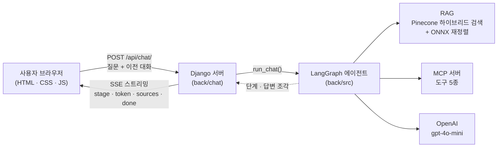

<div align="center">

# 🔍 CodeClue

**LangChain · LangGraph · MCP 개발 오류 분석 및 해결 도우미 (웹 서비스)**

오류 메시지를 입력하면 공식 문서 검색(RAG)과 실시간 도구 조회(MCP)를 근거로 원인과 해결 방법을 알려 주고, 근거가 된 문서의 출처를 함께 보여 주는 개발자용 질의응답 웹 페이지

SKN35 4차 프로젝트 · 2팀


</div>

---

## 목차

1. [프로젝트 개요](#1-프로젝트-개요)
2. [3차 프로젝트에서 달라진 점](#2-3차-프로젝트에서-달라진-점)
3. [주요 기능](#3-주요-기능)
4. [시스템 구성](#4-시스템-구성)
5. [기술 스택](#5-기술-스택)
6. [실행 방법](#6-실행-방법)
7. [디렉토리 구조](#7-디렉토리-구조)
8. [웹 API 규약](#8-웹-api-규약)
9. [테스트](#9-테스트)
10. [배포 (AWS)](#10-배포-aws)
11. [현재 상태와 한계](#11-현재-상태와-한계)
12. [문서](#12-문서)
13. [팀](#13-팀)

---

## 1. 프로젝트 개요

LangChain, LangGraph, MCP를 쓰다 보면 오류 메시지가 흔히 나오는데, 공식 문서가 방대하고 버전마다 달라서 원인을 찾는 데 시간이 오래 걸립니다. CodeClue는 이 문서들을 미리 검색 가능한 형태로 모아 두고, 질문이 들어오면 **관련 문서를 찾아 근거와 함께 답하는** 웹 서비스입니다.

- 답변은 공식 문서에서 찾은 내용을 바탕으로 하고, 어느 문서를 참고했는지 **출처 링크**를 함께 보여 줍니다.
- 문서에 근거가 없는 질문은 지어내지 않고 근거가 부족하다고 답합니다.
- 4차 프로젝트에서는 3차에서 만든 질의응답 엔진(LangGraph 에이전트)을 **Django 웹 서버와 HTML/CSS/JavaScript 화면으로 분리**해서 웹 서비스로 만들었습니다.

## 2. 3차 프로젝트에서 달라진 점

| | 3차 | 4차 (이 저장소) |
|---|---|---|
| 화면 | Streamlit (파이썬 한 덩어리) | **HTML / CSS / JavaScript** (`front/`) |
| 서버 | Streamlit 내장 서버 | **Django** (`back/`) |
| 답변 전달 | 화면 안에서 직접 호출 | **웹 API + 스트리밍(SSE)**: 답변이 한 글자씩 나타남 |
| 실행 환경 | 로컬 | **AWS 클라우드 배포** (배포 절차는 [10장](#10-배포-aws)) |
| 질의응답 엔진 | LangGraph, RAG, MCP, 멀티모달 | **그대로 재사용** (`back/src/`. 엔진은 수정하지 않았고, DB 계층에는 대화 제목 변경 기능만 추가) |

엔진을 새로 만들지 않고 그대로 재사용했기 때문에, 이번 프로젝트의 핵심은 **엔진을 웹 서비스로 안전하게 감싸는 것**입니다. 자세한 변경 내용은 [바뀐 부분과 설계 설명](<docs/팀 설명용/CHANGES_AND_DESIGN.md>)에 정리했습니다.

## 3. 주요 기능

- **질문 → 근거 기반 답변**: 질문을 보내면 처리 단계가 표시되고, 답변이 스트리밍으로 이어서 나타납니다.
- **출처 표시**: 답변에 사용한 공식 문서의 제목과 링크를 목록으로 보여 줍니다. (http/https 링크만 허용)
- **마크다운 답변**: 제목, 목록, 코드 블록, 굵게, 링크를 서식으로 보여 줍니다. 외부 라이브러리 없이 요소를 직접 만들어, 답변 안의 스크립트가 실행되지 않습니다.
- **가입·로그인**: 아이디 3~20자, 비밀번호 8자 이상 + 영문·숫자 필수, 아이디와 비슷한 비밀번호 거부. 로그인은 브라우저를 닫거나 24시간 뒤 종료됩니다.
- **이미지 첨부(멀티모달)**: 📎 버튼, 붙여넣기(Ctrl+V), 끌어놓기로 오류 화면 캡처를 최대 3장 첨부하면 AI가 이미지 속 글자를 읽어 답합니다. 형식은 파일 내용으로 확인하고, 2MB를 넘는 이미지는 자동으로 줄여 저장하며, 대화를 다시 열면 이미지도 다시 보입니다.
- **대화 제목 검색·제목 변경**: 이전 대화의 제목을 바꿀 수 있고(백엔드·화면 구현), 대화 제목으로 목록을 검색할 수 있습니다(백엔드 API, 화면 연결은 프런트 담당).
- **대화 기록**: 대화를 4차 전용 DB에 저장하고, 왼쪽 목록에서 다시 열거나 삭제할 수 있습니다.
- **대화 맥락 유지**: 대화를 DB에 저장하고, 이어지는 질문에는 저장된 이전 대화(상한 안)를 함께 사용합니다.
- **하이브리드 검색 + 재정렬**: 의미 검색과 키워드 검색(BM25 계열)을 합치고, 재정렬 모델로 정확도를 높입니다.
- **MCP 도구 조회**: 패키지 버전, 릴리스 정보 같은 실시간 정보를 도구로 조회합니다.
- **입력 검증과 보안**: 요청 형식·길이 검증, CSRF 보호, 서버 내부 오류 내용을 화면에 노출하지 않음.

## 4. 시스템 구성



한 번의 질문이 처리되는 순서입니다.

1. 화면(`front/static/js/chat.js`)이 질문과 이전 대화를 `/api/chat/`로 보냅니다.
2. Django(`back/chat/views.py`)가 요청을 검증하고, 3차 엔진을 별도 스레드에서 실행합니다.
3. 엔진이 질문 유형을 판단해 문서 검색(RAG), 도구 조회(MCP), 이미지 분석 중 알맞은 경로로 답을 만듭니다.
4. 엔진이 내보내는 처리 단계와 답변 조각을 Django가 받는 즉시 화면으로 흘려 보내고, 마지막에 출처와 전체 답변을 보냅니다.

## 5. 기술 스택

| 영역 | 사용 기술 |
|---|---|
| 프론트엔드 | HTML, CSS, JavaScript (프레임워크 없음) |
| 백엔드 | Python 3.12, Django 5.2 LTS, gunicorn, WhiteNoise |
| 에이전트 | LangChain, LangGraph (Supervisor 구조) |
| 검색 | Pinecone (의미 + 키워드 하이브리드), RRF 결합, ONNX int8 재정렬(bge-reranker-v2-m3) |
| 도구 연동 | MCP (Python SDK 2.x, stdio 서버) |
| 모델 | OpenAI gpt-4o-mini, text-embedding-3-small |
| 데이터 저장 | TiDB Cloud (MySQL 호환), SQLAlchemy |
| 배포 | AWS EC2, nginx, gunicorn |
| 패키지 관리 | uv |

## 6. 실행 방법

> 필요한 것: Python 3.12, [uv](https://docs.astral.sh/uv/), 그리고 API 키(OpenAI, Pinecone)와 DB 접속 정보

**① 의존성 설치**

```bash
uv sync
```

회사나 학원 네트워크에서 인증서 오류(`UnknownIssuer`)가 나면 `uv sync --system-certs`로 실행합니다.

**② 환경변수 파일 만들기** — 비밀값은 저장소에 없으므로 직접 만듭니다.

```bash
copy .env.example back\.env
```

`back/.env`를 열어 `OPENAI_API_KEY`, `PINECONE_API_KEY`, `DB_*` 값을 채웁니다. (위치는 반드시 `back/.env`)

**③ 재정렬 모델 준비** — 용량(약 570MB) 때문에 저장소에 포함하지 않았습니다. 한 번만 변환하면 됩니다.

```bash
uv sync --group export
cd back
uv run python -m src.rag.export_reranker_onnx
cd ..
```

변환된 파일이 `back/data/onnx/bge-reranker-v2-m3-int8/`에 있으면 서버가 자동으로 사용합니다. 이 폴더가 없으면 서버를 켤 때 `chat.W001` 경고로 알려 주고, 질문에는 답할 수 없습니다.

**④ 서버 실행**

```bash
uv run python back/manage.py runserver
```

브라우저에서 `http://127.0.0.1:8000`을 엽니다. 첫 질문은 모델 준비 때문에 몇 초 더 걸릴 수 있습니다.

## 7. 디렉토리 구조

```
SKN35-4th-2team/
├── front/                  ← 화면 (HTML, CSS, JavaScript)
│   ├── templates/chat.html
│   └── static/{css,js}/
├── back/                   ← 서버 (Django)
│   ├── manage.py
│   ├── config/             ← 설정 (settings.py, urls.py, wsgi.py)
│   ├── chat/               ← 질문 창구 (views.py, urls.py, tests.py)
│   ├── src/                ← 3차 질의응답 엔진 (LangGraph, RAG, MCP, 멀티모달, DB)
│   └── data/               ← 검색 보조 데이터, 재정렬 모델(git 제외)
├── docs/                   ← 설명 문서
├── pyproject.toml          ← 의존성
└── .env.example            ← 환경변수 목록 (값 없음)
```

화면과 서버가 폴더로 나뉘어 있어서, 화면 담당자는 `front/`만, 서버 담당자는 `back/`만 보면 됩니다. 둘은 아래의 웹 API 규약으로만 연결됩니다.

## 8. 웹 API 규약

| 주소 | 방식 | 설명 |
|---|---|---|
| `/` | GET | 채팅 화면 |
| `/api/chat/` | POST | 질문 전송(로그인 필요), 답변은 SSE로 스트리밍. 질문, 답변, 출처, 첨부 이미지는 DB에 저장. 이미지는 양식(multipart)으로 최대 3장 |
| `/api/attachments/<번호>/` | GET | 저장된 이미지 (기본 썸네일, `?size=full`이면 원본). 본인 것만, 아니면 404 |
| `/api/auth/signup/` | POST | 가입 (가입과 동시에 로그인, 항상 일반 계정). 아이디 영문 소문자·숫자·밑줄 3~20자, 비밀번호 8자 이상에 영문과 숫자 필수, 아이디와 비슷한 비밀번호는 거부 |
| `/api/auth/login/` | POST | 로그인 (실패 시 401, 아이디 존재 여부는 알려 주지 않음) |
| `/api/auth/logout/` | POST | 로그아웃 |
| `/api/auth/me/` | GET | 현재 로그인한 사용자 (없으면 `{"user": null}`) |
| `/api/conversations/` | GET | 내 대화 목록 (최근 수정순). `?q=검색어`를 붙이면 제목에 검색어가 있는 대화만 (공백으로 나눈 단어가 모두 있으면 찾음, 대소문자 무시, 검색어 100자·결과 50개까지, 대화 내용은 검색하지 않음) |
| `/api/conversations/<번호>/` | GET, DELETE, PATCH | 대화 불러오기(출처 포함) / 삭제 / 제목 변경(`{"title": "새 제목"}`, 공백을 뺀 1~100자, 응답 `{"id", "title"}`). 남의 대화는 404 |
| `/api/health/` | GET | 서버 상태 확인 (`{"status": "ok"}`) |

**요청** `POST /api/chat/`

```json
{"question": "LangGraph에서 checkpointer로 대화 상태를 저장하려면?", "conversation_id": 12}
```

이미지를 함께 보낼 때는 같은 주소로 양식(`multipart/form-data`)을 보냅니다: `question`, `conversation_id`(선택), `images`(png/jpeg/webp, 최대 3장, 한 장 10MB 이하). 이미지만 보내고 질문은 비워도 됩니다.

**응답** `text/event-stream` — 아래 이벤트가 순서대로 옵니다.

| 이벤트 | 내용 |
|---|---|
| `stage` | 현재 처리 단계 이름 (예: "RAG · 공식 문서를 검색하는 중") |
| `token` | 답변 조각 (여러 번) |
| `sources` | 출처 목록 `[{title, url, ...}]` |
| `done` | `{"answer": 전체 답변, "conversation_id": 대화 번호}` |
| `error` | `{"message": 사용자에게 보여 줄 문장, "conversation_id": 대화 번호 또는 null}` (실패 시 `done` 대신) |

`conversation_id`는 이어서 질문할 때만 보내고(없으면 새 대화), 이전 대화(이력)는 서버가 DB에서 읽으므로 화면이 보내지 않습니다. 로그인하지 않았으면 `401`, 잘못된 요청은 `400`(JSON 오류 문장), 허용하지 않는 방식은 `405`, CSRF 검사에 실패하면 `403`을 돌려줍니다.

## 9. 테스트

```bash
uv run python back/manage.py test chat
```

웹 계층의 102개 테스트가 실제 AI·검색을 호출하지 않고(엔진을 가짜로 대체) 아래를 확인합니다.

- 스트리밍 이벤트 순서 (`stage → token → sources → done`)
- 대화 목록, 불러오기, 삭제: 로그인 필요, 남의 대화는 404, DB 오류 내용 비노출, 삭제 시 CSRF 검사
- 대화 제목 검색: 실제 SQL로 대소문자 무시, `%`·`_` 글자 그대로 검색, 단어 단위 검색, 대화 내용은 검색하지 않음, 남의 대화 제외, 최근 수정순
- 제목 변경: 공백을 뺀 1~100자 검증, 남의 대화 차단, 목록 순서 유지
- 이미지 업로드: 이미지 전달, 이미지만 보내기, 3장 초과·10MB 초과 거부, 저장된 이미지는 본인만(404), 안전한 응답 헤더
- 로그인 필요(401), 사용자 번호는 세션에서만 가져오고 요청 본문의 값은 무시, 대화 번호 검증
- 엔진 오류 결과를 `error` 이벤트로 변환, 예외 내용은 화면에 노출하지 않음
- 잘못된 JSON, 빈 질문, 너무 긴 질문 거부(400), GET 거부(405), CSRF 검사(403)
- 가입·로그인·로그아웃·내 정보: 가입 규칙(아이디 길이, 비밀번호 영문+숫자, 아이디와 유사한 비밀번호 거부), 관리자 가입 차단, 로그인 실패 문구 통일, 세션 키 교체, 브라우저 종료 시 만료, CSRF 검사, DB 오류 내용 비노출
- 서버 시작 시 모델 준비(웜업)를 건너뛰는 규칙

질의응답 품질(검색 정확도, 답변 평가)은 3차 프로젝트의 평가 결과를 따르며, 4차에서 엔진은 수정하지 않았습니다. 4차의 화면 시나리오 테스트와 결과는 테스트 계획 및 결과 보고서에 별도로 기록합니다.

## 10. 배포 (AWS)

- 구성: **EC2 서버 1대**에서 nginx(요청 받기·정적 파일) → gunicorn(Django 실행)
- 답변이 한 글자씩 나타나도록 nginx에서 응답 버퍼링을 끄고(`proxy_buffering off`), 서버가 `X-Accel-Buffering: no` 헤더를 보냅니다.
- 운영 필수 환경변수: `DJANGO_DEBUG=0`, `DJANGO_SECRET_KEY`, `DJANGO_ALLOWED_HOSTS`, `DJANGO_CSRF_TRUSTED_ORIGINS` (설명은 `.env.example`)
- 정적 파일은 `collectstatic`으로 모아 WhiteNoise가 제공합니다.

단계별 절차는 [AWS 배포 순서](docs/DEPLOY_AWS.md)에 있습니다. 배포 주소와 서버 구성도는 배포 완료 후 이 항목과 시스템 구성도 문서에 기록합니다.

## 11. 현재 상태와 한계

**동작하는 것**: 가입·로그인, 이미지 첨부 질문, 질문 → 스트리밍 답변(마크다운) → 출처 표시, 대화 저장·목록·불러오기·삭제, 입력 검증, 웹 계층 테스트 102개

**아직 하지 않은 것**
- 관리자 화면(사용자 목록, 비밀번호 초기화): 3차 DB 계층에 기능은 있으나 4차 화면은 없습니다.
- 로그인 시도 횟수 제한(무차별 대입 방지)

**알려진 제약**
- 로그인 상태는 서명된 쿠키에 담습니다(위조 불가, 장고 DB 마이그레이션 불필요). 로그아웃은 브라우저의 쿠키를 지우는 방식이라, 이미 복사된 쿠키를 서버에서 미리 무효화할 수는 없고 최대 24시간 안에 만료됩니다.
- 학원·회사 네트워크처럼 보안 장비가 인증서를 바꾸는 환경에서도 외부 서비스(Pinecone 등)에 접속되도록 운영체제 인증서 저장소(`truststore`)를 사용합니다. 인증서 검증을 끄지는 않습니다.
- 서버 시작 시 모델 준비(웜업)와 재정렬 모델이 메모리를 사용하므로, 서버 사양이 너무 작으면 느려질 수 있습니다.
- 문서 범위는 LangChain, LangGraph, MCP 공식 문서이며, 그 밖의 주제는 근거 부족으로 답합니다.

## 12. 문서

| 문서 | 내용 |
|---|---|
| [바뀐 부분과 설계 설명](<docs/팀 설명용/CHANGES_AND_DESIGN.md>) | 3차 대비 변경점, 구조 설계의 이유, 질문 처리 흐름 |
| [팀 규칙](<docs/팀 설명용/TEAM_RULES.md>) | 팀원용: 폴더별 담당, 작업 방법, 규칙 |
| [AWS 배포 순서](docs/DEPLOY_AWS.md) | EC2, nginx, gunicorn 설정과 확인 절차, 문제 해결 (설정 파일은 `docs/deploy/`) |

## 13. 팀

SKN35 2팀 — 나치훈, 박찬룡, 고은하, 박종원
