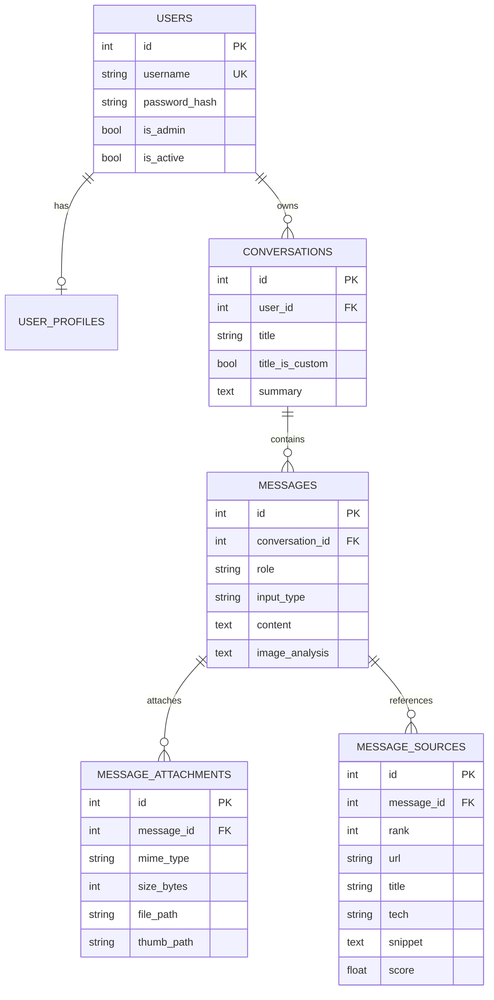

# ERD (데이터베이스 구조)

3차 프로젝트의 ERD를 그대로 가져온 것입니다. 4차에서 `conversations` 테이블에 `title_is_custom`(사용자가 직접 바꾼 제목인지) 컬럼 1개가 추가되었습니다(마이그레이션 `0006`). 그 밖의 구조는 3차와 같고, 장고는 자체 테이블을 쓰지 않습니다.

GitHub와 VS Code(Mermaid 확장)에서 그림으로 보입니다. 이미지가 필요하면 https://mermaid.live 에 아래 코드를 붙여 넣어 PNG/SVG로 내려받으세요.

