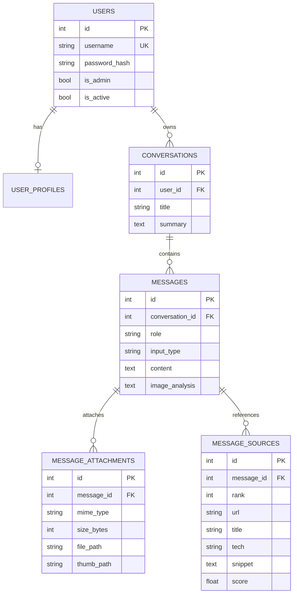

# ERD (데이터베이스 구조)

3차 프로젝트의 ERD를 그대로 가져온 것입니다. 4차에서 DB 구조는 바뀌지 않았습니다 (`back/src/db/models.py`, `schema.sql`, `migrations/`가 3차와 동일, 장고는 자체 테이블을 쓰지 않음).

GitHub와 VS Code(Mermaid 확장)에서 그림으로 보입니다. 이미지가 필요하면 https://mermaid.live 에 아래 코드를 붙여 넣어 PNG/SVG로 내려받으세요.

