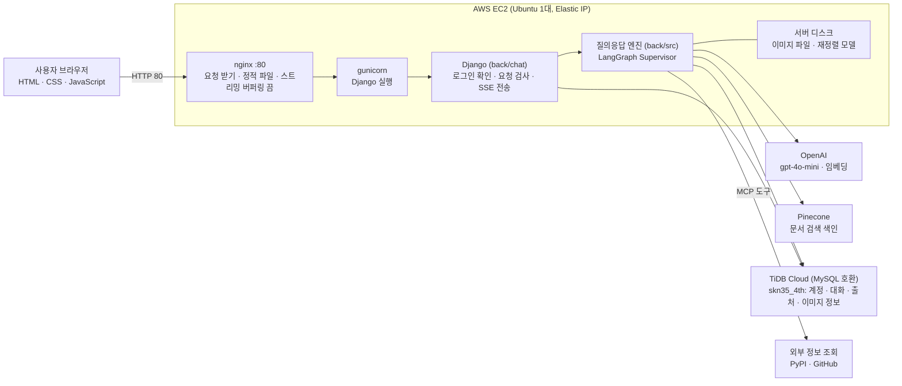
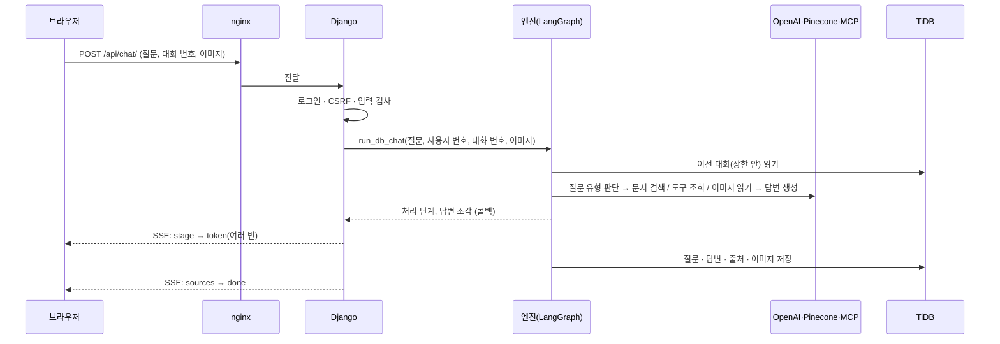
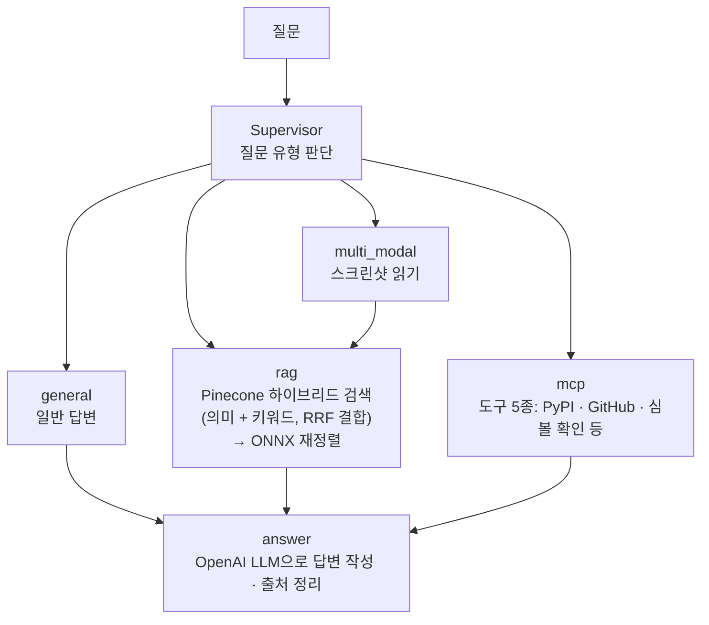

# 시스템 구성도

- 프로젝트: CodeClue (SKN35 4th 2Team)
- 기준일: 2026-11-04
- 표기: 서버 주소와 사양은 배포가 끝나면 아래 「4. 배포 환경」 표에 기록한다.

목차

1. [전체 구성](#1-전체-구성)
2. [질문 한 번이 처리되는 순서](#2-질문-한-번이-처리되는-순서)
3. [서버 안의 구성](#3-서버-안의-구성)
4. [배포 환경](#4-배포-환경)
5. [데이터 저장](#5-데이터-저장)
6. [보안 구성](#6-보안-구성)
7. [구성 요소 목록](#7-구성-요소-목록)

---

## 1. 전체 구성

핵심은 **브라우저 ↔ 웹 서버(Django) ↔ 질의응답 엔진 ↔ 외부 서비스** 네 층이다. 화면은 서버와 API 약속(README 8장)으로만 연결되고, 엔진은 3차 코드를 그대로 쓴다.

## 2. 질문 한 번이 처리되는 순서

실패하면 `done` 대신 `error` 이벤트로 사용자에게 보여 줄 문장만 보낸다(내부 오류 내용은 보내지 않음).

## 3. 서버 안의 구성

| 폴더 | 역할 |
| --- | --- |
| `front/` | 화면: `templates/chat.html`, `static/css`, `static/js`(채팅, 마크다운 그리기) |
| `back/config/` | Django 설정, 주소 연결, WSGI |
| `back/chat/` | 웹 창구: 질문 스트리밍, 가입 · 로그인, 대화 목록 · 삭제 · 제목 변경 · 검색 · 고정, 이미지 보기 |
| `back/src/` | 3차 엔진: LangGraph, RAG, MCP, 멀티모달, DB 계층(SQLAlchemy · Alembic) |
| `back/data/onnx/` | 재정렬 모델(용량 때문에 저장소에서 제외, 서버에 직접 복사) |
| `docs/deploy/` | nginx 설정, systemd 서비스 파일 |

## 4. 배포 환경

| 항목 | 값 |
| --- | --- |
| 서버 | AWS EC2 1대(인스턴스 이름 `4th_2team`), Ubuntu, 서울 리전 |
| 사양 | 인스턴스 유형 `t3.small` (vCPU 2, 메모리 2GiB), 리전 `ap-northeast-2`(서울), Elastic IP 연결. 처음 `t3.micro`(1GiB)로 배포했다가 메모리 부족으로 변경 — 실제 사용량은 아래 실측 표에 기록 |
| 주소 | `http://3.38.62.192/` (Elastic IP, HTTP) |
| 프로세스 | nginx(80) → gunicorn(내부 `127.0.0.1:8000`, systemd 서비스 `codeclue`) |
| 정적 파일 | `collectstatic`으로 모아 WhiteNoise가 제공 |
| 보안 그룹 | 22(SSH, 관리자 IP만), 80(전체), 443(HTTPS를 쓸 때). **8000은 열지 않는다** |
| 서버 폴더 | `/home/ubuntu/SKN35-4th-2team` |
| 이미지 저장 폴더 | `/home/ubuntu/codeclue-uploads` (`IMAGE_STORAGE_DIR`, 저장소 밖이라 재배포해도 유지) |
| 스왑 | 2.0GiB (메모리 부족 시 보완) |
| 비밀값 | `back/.env`(파일로 직접 전달, 저장소에 없음) |
| HTTPS | 도메인이 있을 때만 적용. 없으면 HTTP + IP로 서비스(한계로 명시) |

| 실측 항목 | 값 | 측정일 |
| --- | --- | --- |
| 서버 시작 후 첫 질문 응답 시간 | ______ 초 | |
| 두 번째 이후 질문 응답 시간 | ______ 초 | |
| 메모리 사용량 — `t3.micro` 시점(`free -h`) | 전체 909MiB 중 사용 815MiB, 사용 가능 94MiB. 스왑 2.0GiB 중 1.0GiB 사용 → 부족하여 `t3.small`로 변경 | 2026-11-05 |
| 메모리 사용량 — `t3.small` 변경 후(`free -h`) | 전체 1.9GiB 중 사용 1.2GiB, 사용 가능 703MiB. 스왑 사용 60KiB | 2026-11-05 |
| 메모리 사용량 — `t3.small`, 이미지 질문 답변 중(`free -h` 2회) | 전체 1.9GiB 중 사용 1.4GiB, 사용 가능 약 468~469MiB. 스왑 사용 60KiB(거의 안 씀) | 2026-11-05 |
| 메모리 부족으로 인한 프로세스 강제 종료 기록(`dmesg`) | 없음 | 2026-11-05 |

배포 절차: 저장소의 AWS 배포 순서 문서(`docs/DEPLOY_AWS.md`)

## 5. 데이터 저장

| 저장소 | 내용 | 비고 |
| --- | --- | --- |
| TiDB Cloud `skn35_4th` | 사용자, 대화, 메시지, 출처, 이미지 정보, (고정 표시 테이블) | 서버 밖의 관리형 DB. ERD는 저장소의 `docs/ERD.md` |
| 서버 디스크 | 업로드한 이미지 파일과 축소본, 재정렬 모델 | 이미지 경로만 DB에 기록 |
| Pinecone `skn35-rag` | 공식 문서 색인 | 3차에서 만든 것을 그대로 사용(읽기만) |
| 브라우저 쿠키 | 로그인 상태(서명된 쿠키) | 서버에 세션 테이블 없음 |

3차 DB(`skn35_3rd`)와 4차 DB(`skn35_4th`)는 서로 섞지 않는다.

## 6. 보안 구성

| 위협 | 대응 |
| --- | --- |
| 남의 대화 · 이미지 접근 | 사용자 번호를 세션에서만 가져오고 모든 조회에 조건으로 넣는다. 없으면 404 |
| 요청 위조 | CSRF 검사(실패 403) |
| 답변 속 악성 스크립트 | 요소를 직접 만들어 그리고 http/https 링크만 허용 |
| 오류 내용 노출 | 사용자에게는 안내 문구만, 내부 내용은 서버 로그에만 |
| 비밀값 유출 | `.env` · `.pem` · 모델 · 큰 파일을 저장소에 올리지 않음, 보안 그룹은 필요한 포트만 |
| 업로드 악용 | 개수(3장) · 크기(10MB) · 형식(png/jpeg/webp, 실제 바이트로 검사) 제한 |
| 로그인 쿠키 위조 | 비밀키로 서명. HTTPS에서는 보안 쿠키 |
| 한계 | 로그인 시도 횟수 제한 없음, 로그아웃의 서버 측 무효화 불가, HTTP 서비스 시 비밀번호 비암호화 |

## 7. 구성 요소 목록

| 영역 | 기술 |
| --- | --- |
| 화면 | HTML, CSS, JavaScript(프레임워크 없음) |
| 웹 서버 | Django 5.2 LTS, gunicorn, nginx, WhiteNoise |
| 에이전트 | LangChain, LangGraph(Supervisor) |
| 검색 | Pinecone(하이브리드), ONNX int8 재정렬(`bge-reranker-v2-m3`) |
| 도구 연동 | MCP Python SDK 2.x(stdio 서버) |
| 모델 | OpenAI `gpt-4o-mini`, `text-embedding-3-small` |
| DB | TiDB Cloud(MySQL 호환), SQLAlchemy 2, Alembic |
| 클라우드 | AWS EC2, Elastic IP, 보안 그룹 |
| 패키지 관리 | Python 3.12, uv |
